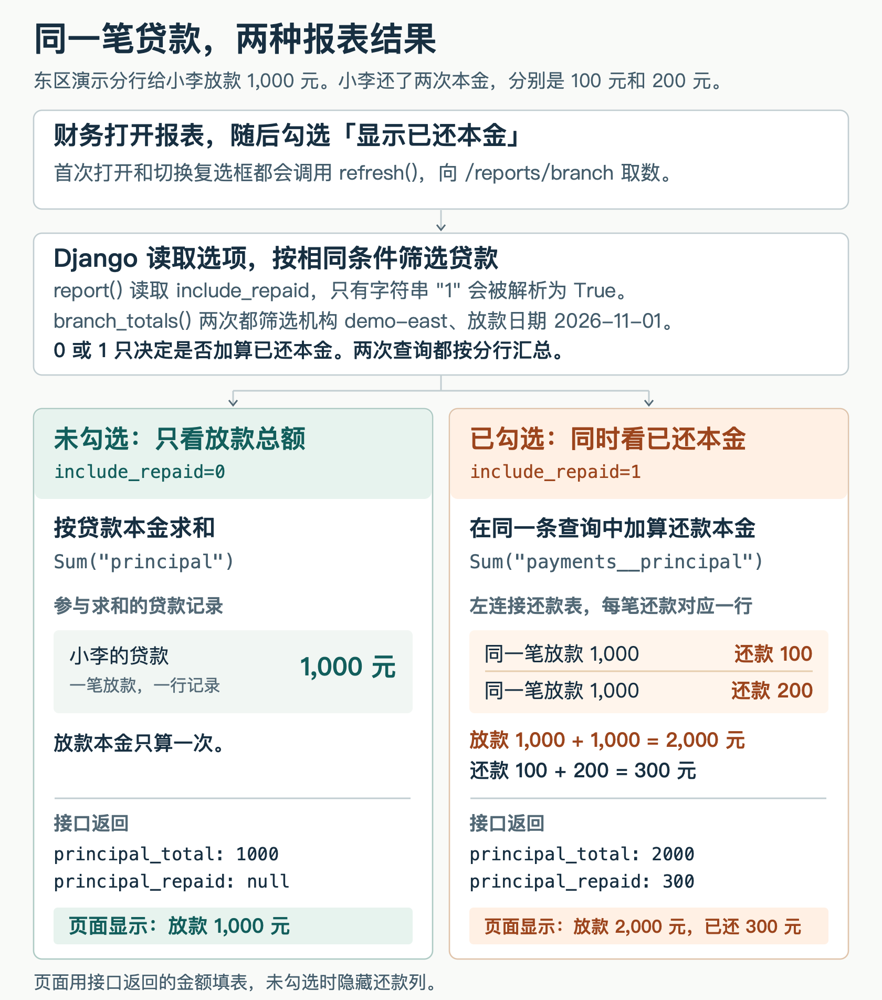

# 勾选“显示已还本金”，Django 报表里的放款总额为什么翻了一倍？

东区演示分行在 2026 年 11 月 1 日只给小李发放了一笔 1,000 元贷款。小李先还了 100 元本金，又还了 200 元。放款总额应该始终是 1,000 元，已还本金应该是 300 元。

下图沿同一份示例账本对照两次请求，从勾选报表列一直到浏览器收到汇总金额。



## 运行报表

示例使用 Python 3.12、Django 5.2.8 和 Python 自带的 SQLite。

```sh
git clone https://github.com/123liuziming/qoder-live-debug-django-report.git
cd qoder-live-debug-django-report
python3.12 -m venv .venv
. .venv/bin/activate
python -m pip install -r requirements.txt
python serve.py
```

打开 <http://127.0.0.1:8080/>，先看放款总额，再勾选“显示已还本金”。默认端口被占用时，可用 `REPORT_PORT=8081 python serve.py` 换端口。

| 页面操作 | 放款总额（元） | 已还本金（元） |
| --- | ---: | ---: |
| 打开页面 | 1,000 | 未显示 |
| 勾选“显示已还本金” | 2,000 | 300 |

首次启动会在项目目录创建 `report.sqlite3` 并写入一笔贷款和两笔还款，再次启动会沿用已有数据。按 Ctrl+C 停止服务。

## 对照两个请求

在另一个终端执行下面的两次查询。

```sh
curl 'http://127.0.0.1:8080/reports/branch?branch=demo-east&issued_on=2026-11-01&include_repaid=0'
curl 'http://127.0.0.1:8080/reports/branch?branch=demo-east&issued_on=2026-11-01&include_repaid=1'
```

两次请求只改了最后一个参数。`ledger/views.py` 接收参数，把查询交给 `ledger/reports.py` 的 `branch_totals()`。浏览器直接显示接口返回的金额。用 Qoder IDE 打开项目时，可以从这两个文件对照请求的执行路径。

<details>
<summary>为什么会多出 1,000 元？</summary>

只看放款总额时，数据库只需要对贷款求和，小李的 1,000 元出现一次。勾选还款列后，第 10 行的 `Sum("payments__principal")` 让第 11 行组装的查询关联还款表。小李还了两次，这笔贷款在参与求和的结果里就有两行。

| 贷款 | 放款本金（元） | 这次归还的本金（元） |
| --- | ---: | ---: |
| 小李的同一笔贷款 | 1,000 | 100 |
| 小李的同一笔贷款 | 1,000 | 200 |

数据库逐列求和，得到了 2,000 和 300。可以分别从贷款表和还款表按同一机构、同一放款日期求和。验证修复时，再建一笔同额贷款，确保两笔 1,000 元都会计入放款总额。

</details>

案例原型见 [Django 工单 #10060](https://code.djangoproject.com/ticket/10060)。
